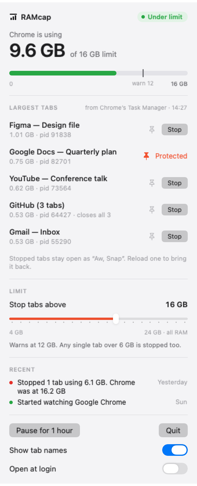
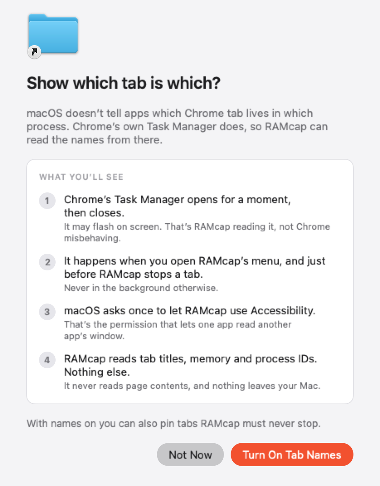

# RAMcap

**Set a memory limit for Chrome.**

RAMcap is a small macOS menu bar app. It shows how much memory Chrome is using,
warns you when it gets high, and stops the largest tab when Chrome hits the
limit you set, before macOS runs out of memory and freezes every app.

<p align="center">
  
</p>

## Why

Chrome has no memory limit. Memory Saver puts idle tabs to sleep, which lowers
the usual level, but it is not a ceiling: it never touches the tab you are
using, or tabs playing media, in a call, or holding unsaved input. One runaway
tab can take Chrome past 30 GB and macOS starts pausing apps ("Your system has
run out of application memory").

A Chrome extension can't fix this. It can't read a tab's memory on the stable
channel, and it freezes along with Chrome. RAMcap runs outside Chrome.

**Memory Saver sleeps idle tabs. RAMcap sets the limit Chrome doesn't have.**

## How it works

- Every 15 seconds RAMcap adds up the real memory footprint of every Chrome
  process (the same number Activity Monitor shows).
- At the warning level (50% of your RAM by default) it sends a notification.
- At the limit (65% of RAM by default) it picks the largest tab and tells you:
  "Stopping 1 Chrome tab in 20 s", with **Protect** and **Stop now**. If Chrome
  is still over the limit after 20 seconds, that tab's process is stopped.
- Any single tab above 25% of RAM is stopped as well.
- A stopped tab stays open as "Aw, Snap". Reload it to bring it back.

RAMcap never stops Chrome itself, its extensions or its GPU process, only tabs.
You can change the limit with the slider, pause for an hour, and start RAMcap
at login.

### Tab names (optional)

macOS doesn't tell apps which Chrome tab lives in which process, so by default
RAMcap shows each tab's size and process ID. Turn on **Show tab names** and
RAMcap reads the titles from Chrome's own Task Manager. You can then pin tabs
RAMcap must never stop.

This needs Accessibility permission, and a one-time sort of Chrome's Task
Manager by memory. The setup window walks you through both. RAMcap reads tab
titles, memory and process IDs, nothing else, and nothing leaves your Mac.

<p align="center">
  
</p>

## Install

Requires macOS 14 or later and Google Chrome.

```sh
brew tap lior-pesoa/tap
brew trust lior-pesoa/tap      # Homebrew asks you to trust third-party taps once
brew install --cask lior-pesoa/tap/ramcap
```

Or download `RAMcap-<version>.zip` from
[Releases](https://github.com/lior-pesoa/ramcap/releases), unzip it, and move
RAMcap to Applications. The app is signed and notarized by Apple.

## Limits

- RAMcap **stops** tabs, it doesn't sleep them. Anything unsaved in a stopped
  tab is lost. Protect tabs you can't lose.
- It can't tell which tab is in front, so the largest tab goes even if it's the
  one you're looking at (you get 20 seconds to protect it).
- One Chrome process can hold several tabs of the same site. Stopping it
  closes all of them; the menu says so ("closes all 3").
- Tab names work only with Chrome set to English, and may break when Chrome
  changes its Task Manager.
- Google Chrome only, for now. Other Chromium browsers are planned.

## Build from source

```sh
swift test                                  # tests
scripts/make-app.sh .build/app              # ad-hoc signed RAMcap.app
swift run ramcap status                     # command line: what RAMcap sees
swift run ramcap dry-run                    # what it would do right now
```

`scripts/release.sh <version> <build>` builds a notarized release (needs the
maintainer's Apple Developer account).

## License

MIT. See [LICENSE](LICENSE).
